# 基本操作

**✅点击打开服务器后台➡ [菜菜云MLSG服务器管理后台](https://panel.mr-leaves.com/){target=_blank}**  
本页说明后台每个功能的用途；具体每个游戏的图文教程请看后续章节。

---

## 1.仪表盘

这里列出全部的服务器，点卡片即可进入对应操作界面。  
安装中的服务器部分功能不可用；**安装完成后系统会发邮件**，无需一直刷新。  
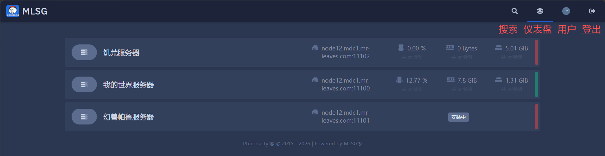  

  <!-- 完美间距 -->

## 2.操作页面

进入服务器后，左侧就是功能导航。

### 2.1.控制台
开机/关机/重启、实时日志、命令输入、资源占用  
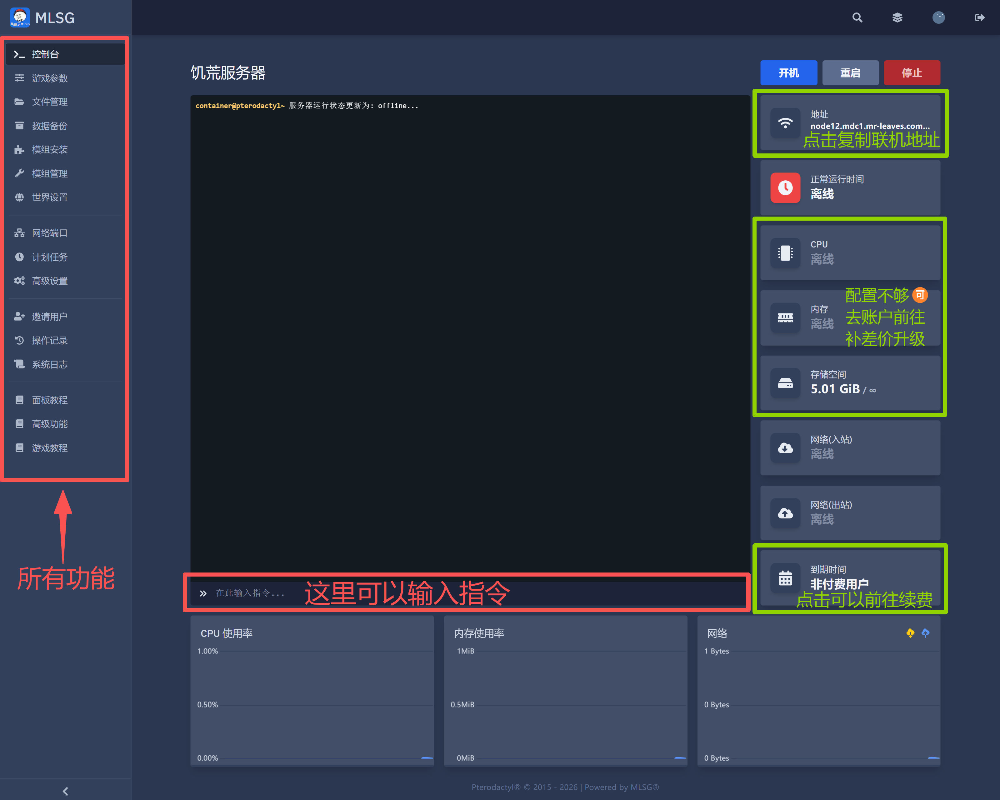  

  <!-- 完美间距 -->
### 2.2.游戏参数
启动命令与服务器变量都在这里（启动命令由我们维护，变量可自己改）  
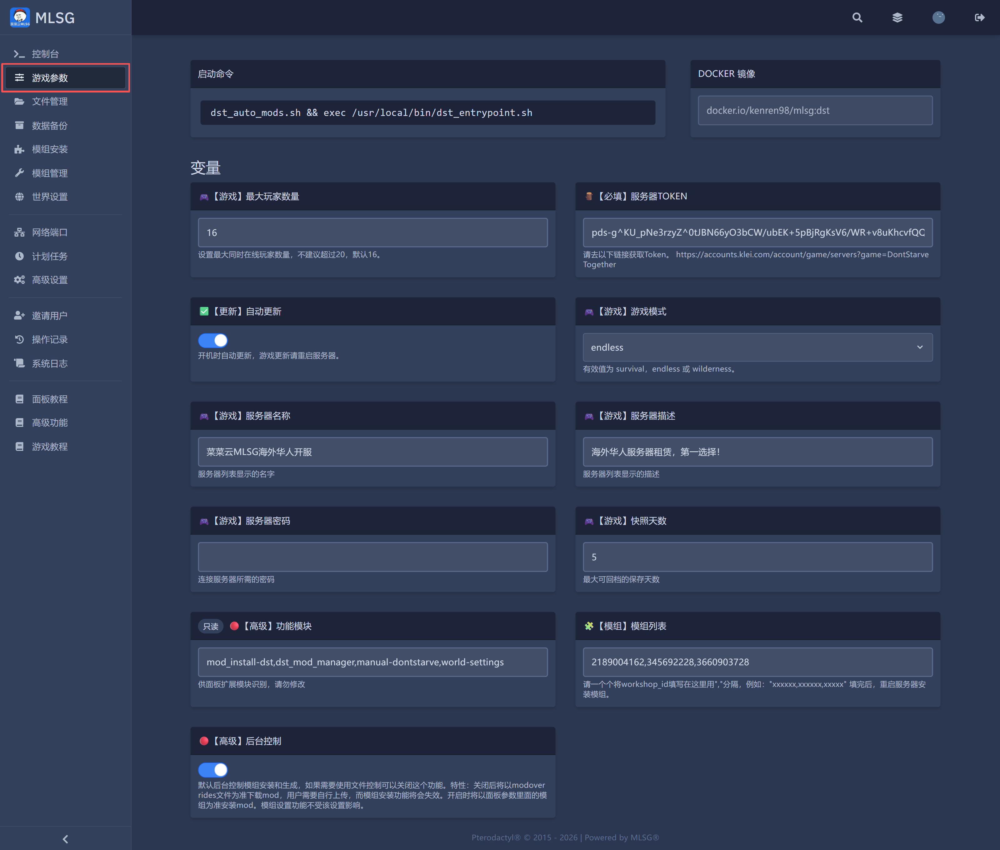

<strong>🪵必填 / ⭐️常用 / 🧩模组 / 📦整合包 / 🎮游戏 / ⚙️网络 / 🔴高级 / ⚠️警告</strong> <strong>⚠️用【一键安装】装核心或整合包时，变量会被自动改写，不要同时手动修改。</strong>

  <!-- 完美间距 -->
### 2.3.文件管理
在线浏览、上传、编辑服务器文件（单次不超过 100M、50 个文件）  
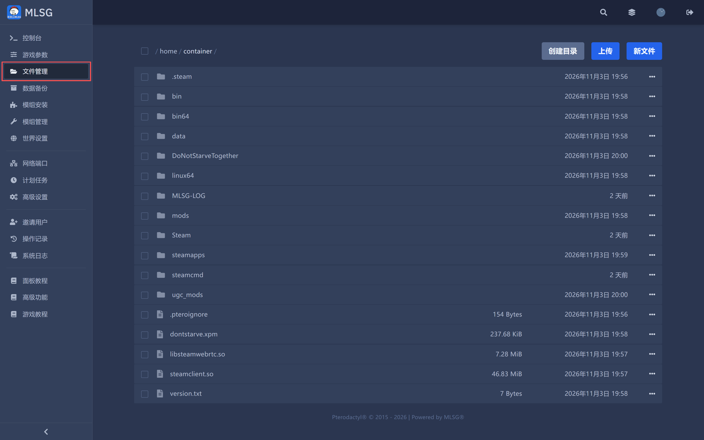

<strong>注：超过50个文件，或超过100M请使用<a href="/2-serveradvanced/filetransfer/">该教程</a>传输文件</strong>

  <!-- 完美间距 -->
### 2.4.数据备份
创建与还原备份（请在服务器关闭状态下创建）  
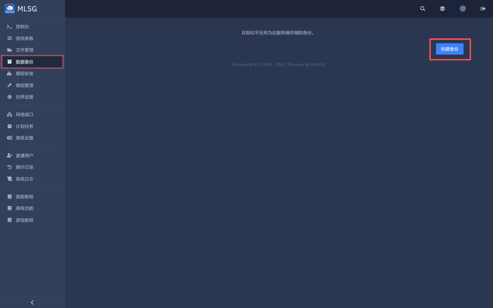  

  <!-- 完美间距 -->
### 2.5.网络端口
查看可用端口（第一个通常就是连接端口）  
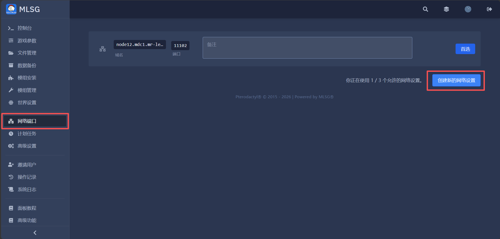  

  <!-- 完美间距 -->
### 2.6.计划任务
定时执行指令、备份、重启  
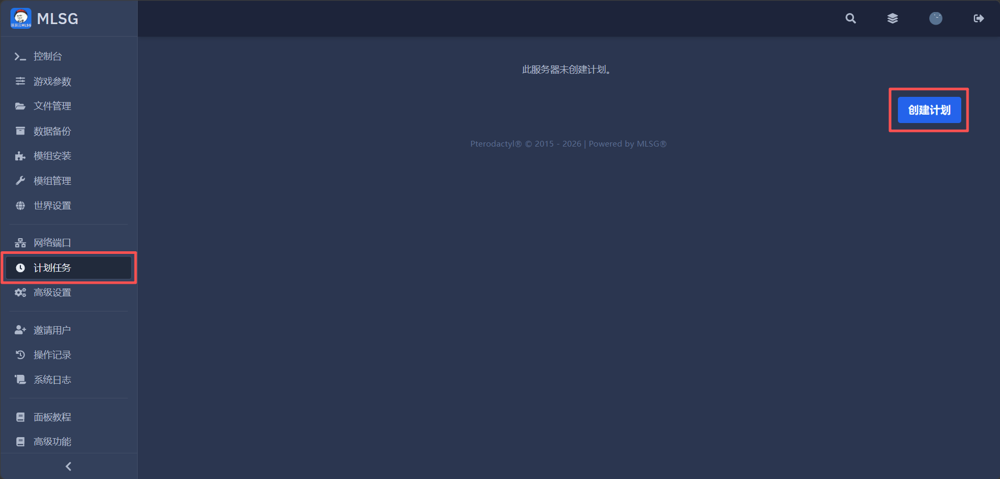  

  <!-- 完美间距 -->
### 2.7.高级设置
SFTP 连接信息、重装服务器  
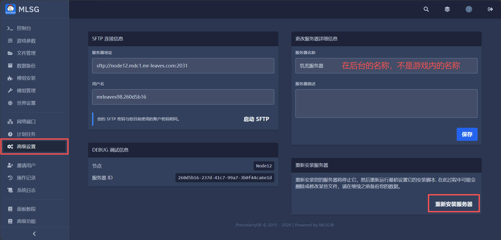  

  <!-- 完美间距 -->
### 2.8.邀请用户
邀请其他人一起管理服务器（对方需要开启 2FA）  
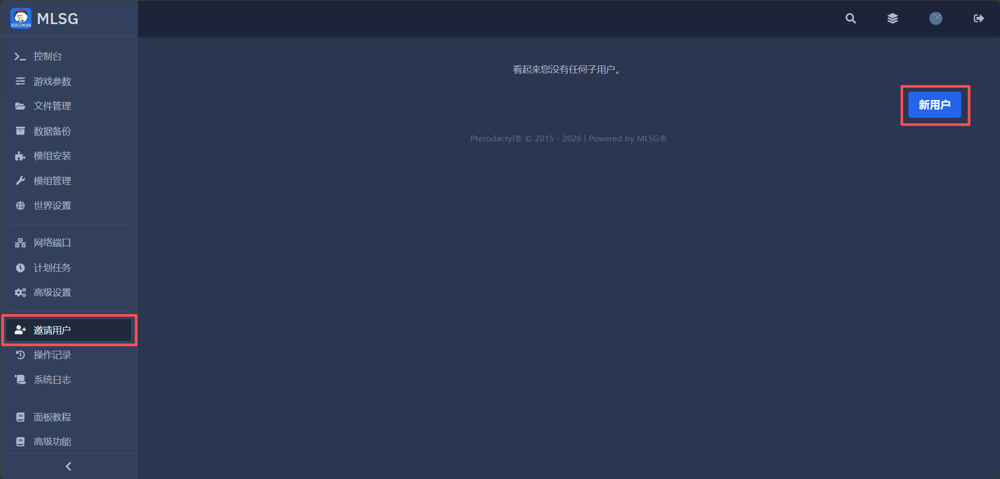  

  <!-- 完美间距 -->
### 2.9.操作记录
谁在什么时候做了什么，都在这里  
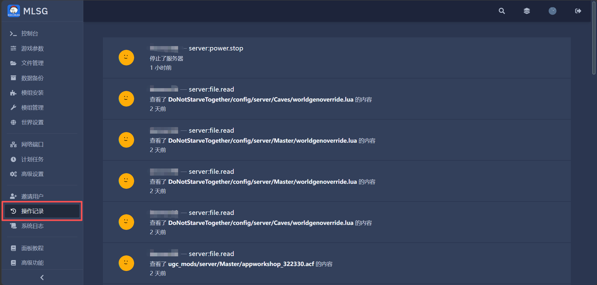  

  <!-- 完美间距 -->
### 2.10.系统日志
安装 / 启动 / 关机 / 模组 的完整脚本日志（开服失败、模组下载失败先看这里）  
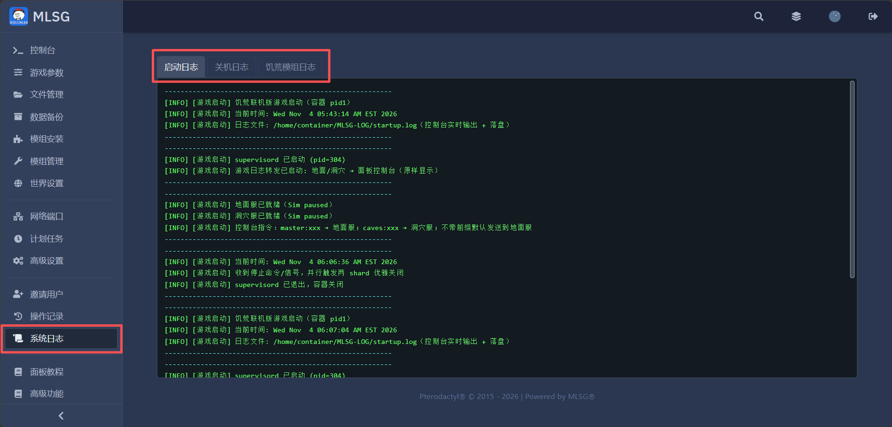

<strong>✅日志可点击分页切换</strong>

<strong>⚠️报错请整段复制给客服，不要只截最后一行。</strong>

