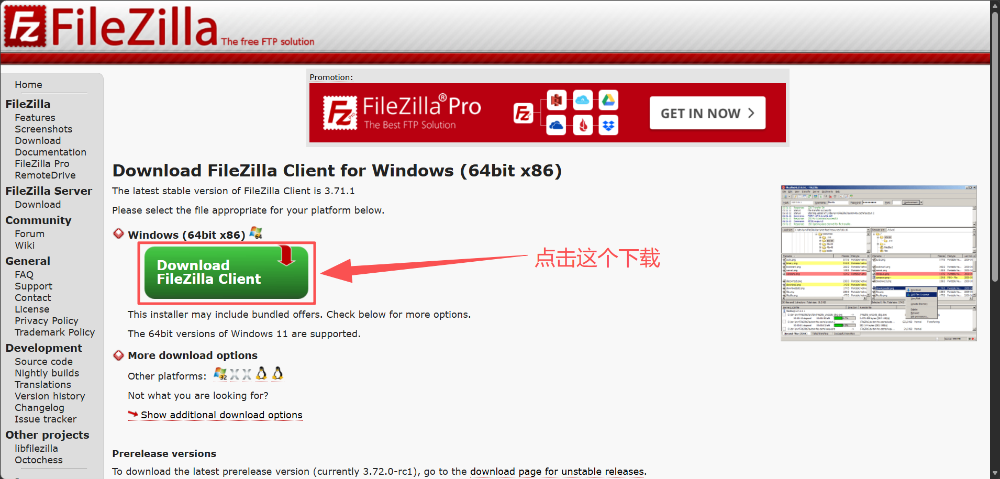
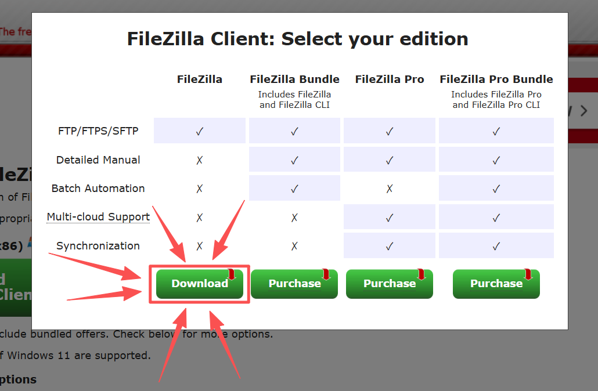
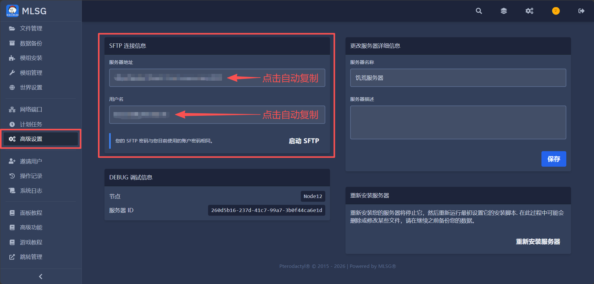
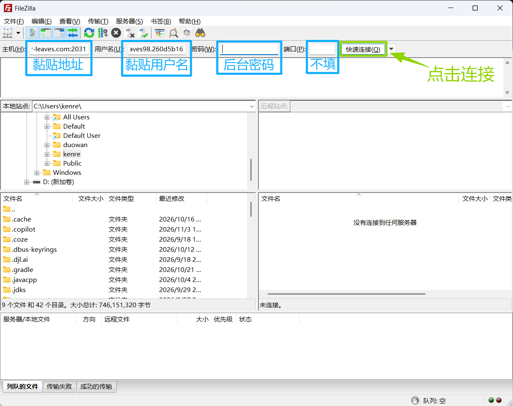
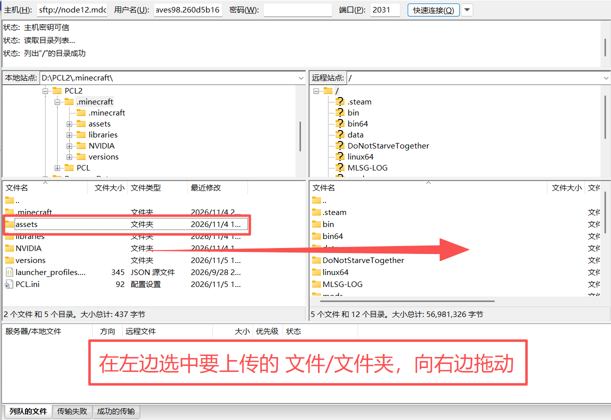

# SFTP传输大文件
因为网页传输限制，**超过100M，或50个文件，强烈建议使用SFTP传输**，否则很可能中途断传。

---

## 1.下载并安装FileZilla

去**[FileZilla官网](https://filezilla-project.org/download.php?type=client)**下载最新版本，并安装  
  
  
 

## 2.在服务器后台找到连接信息

在服务器后台的 **【高级设置】** 页面里找到 **SFTP 连接信息**  
   
 

## 3.填入连接信息并连接

使用FileZilla客户端，创建连接，并从左边文件夹往右边拖拽文件，以传输。  
   
  
 