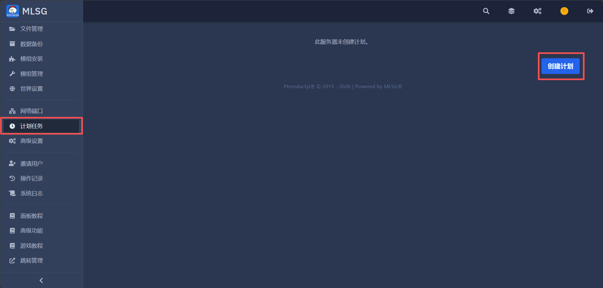
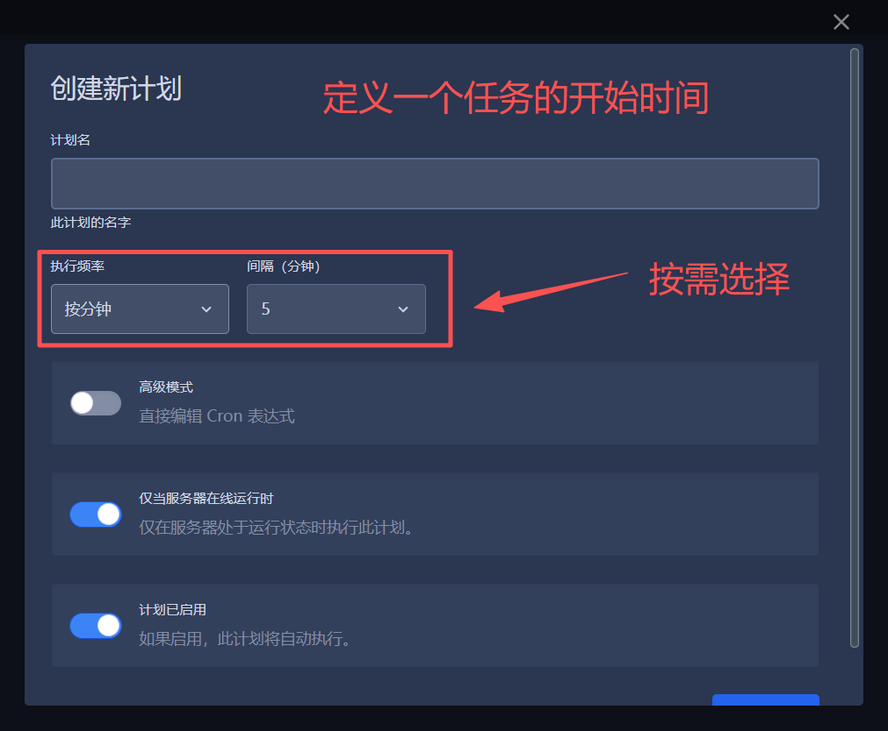
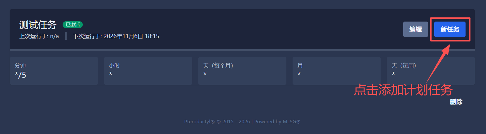
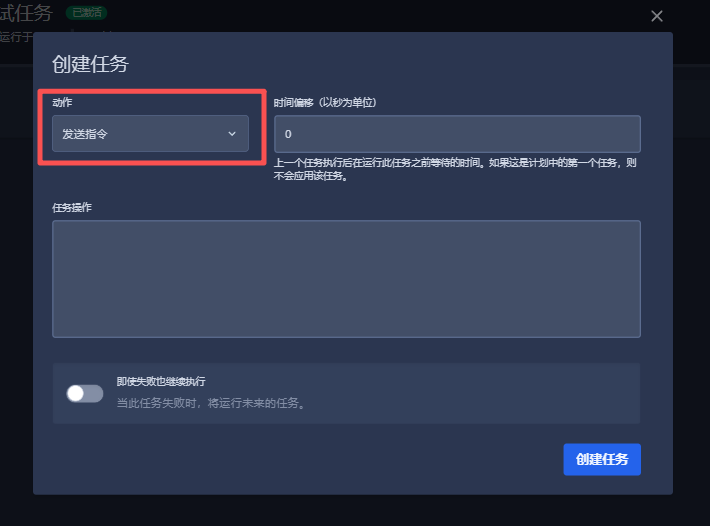

# 创建服务器计划任务
服务器**计划任务**（菜单原名"计划"）通常用于，备份，周期性指令，重启等周期性的操作。

---

## 1.创建计划
在后台找到计划任务，点击 **【创建计划】**  
  
 

## 2.触发时间
选择计划需要触发的时间规律，**请不要设置过于接近**  
   
 

## 3.添加任务
计划内的任务从上往下执行，**时间偏移代表和上个任务的时间差**  
 
 
 