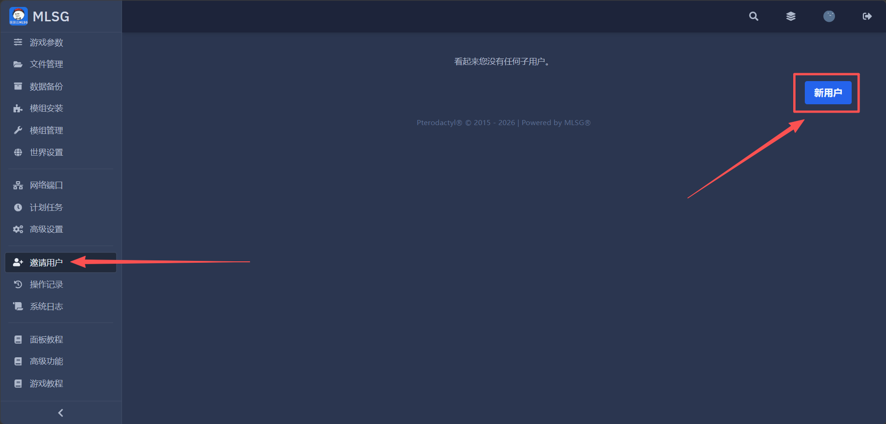
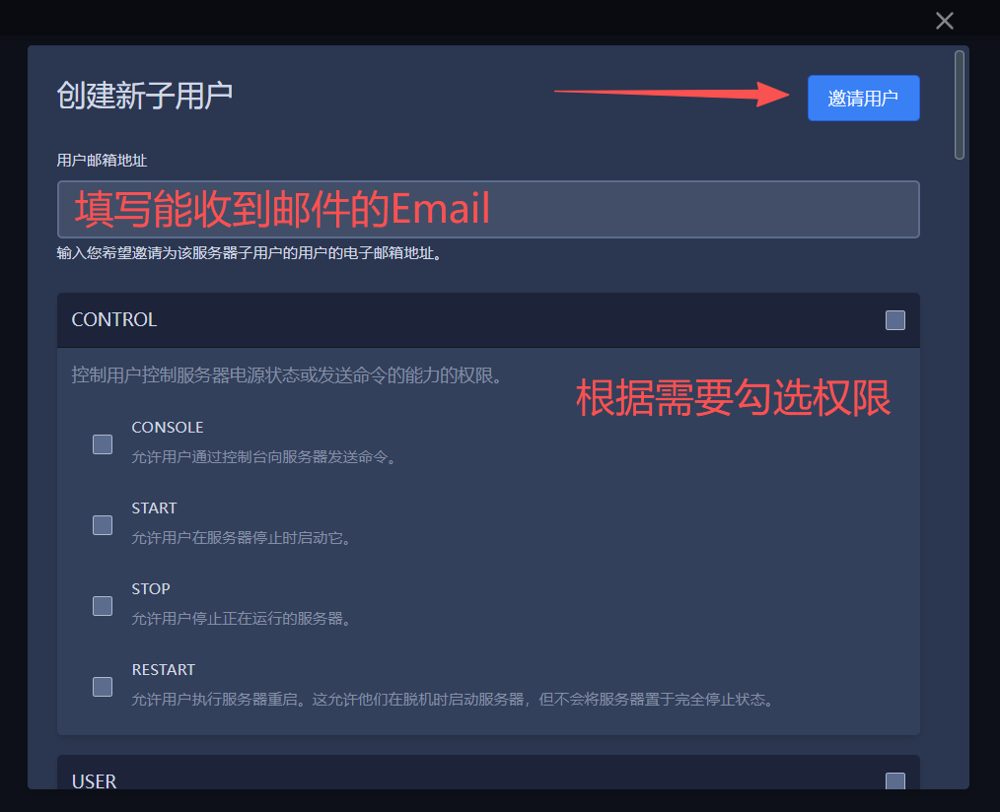

# 邀请子用户管理
邀请更多用户管理你的服务器，子用户帐户和普通帐户一样可以复用。

---

## 1.打开邀请用户界面
（左侧菜单现在的名字是 **【邀请用户】**，原名"子用户"）  

 

## 2.邀请并填入权限

 

## 3.子用户登录后台
请让子用户在收到的邮件链接里完成密码设置，在 [【MLSG管理后台】](https://panel.mr-leaves.com/){target=_blank} 登录  
即可看到您共享的服务器，可以点击下方复制链接分享

<!-- Display the link and button in a flexbox container -->

    <code>https://panel.mr-leaves.com/</code>
    <button class="copy-btn" onclick="copyToClipboard()">点我复制链接</button>

链接已复制

<!-- CSS for the button, notification, and flexbox container -->

<!-- JavaScript to copy the link to clipboard and show notification -->

 