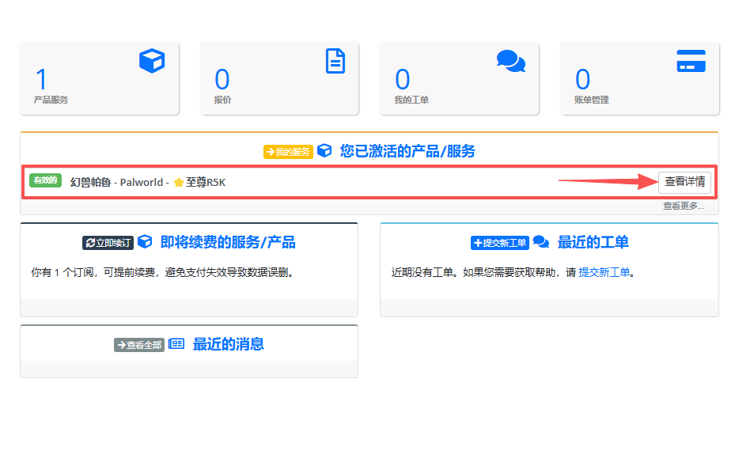
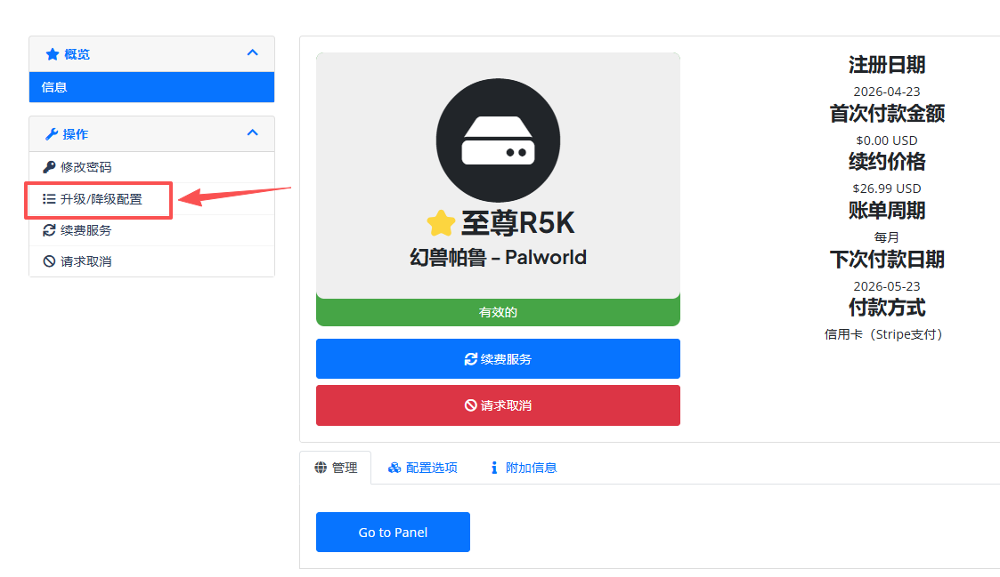
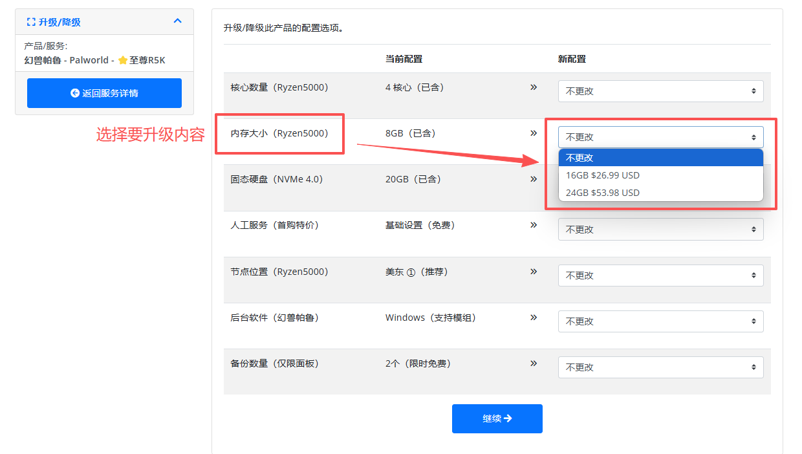

# 配置升级

## 1.官网自助升级（推荐）
### ✅按天数补差价
点击下方 **[菜菜云MLSG - 账户登陆](https://mlsg.mr-leaves.com/store/index.php?rp=/login)**，按下面 5 步操作  
系统会 **根据未使用时长自动计算差价**，支付差价即完成升级。  

> 1. 进入 **【账户】** 界面
> 2. 点击 **【产品信息】**
> 3. 找到要升级的服务器
> 4. 点击 **【配置升级】**，选择需要升级到的配置
> 5. 核对系统算出的差价，支付完成升级（**到期日不变**）

**详细操作，可以参考下方图文教程**  

  <a href="https://mlsg.mr-leaves.com/store/index.php?rp=/login"
     style="display:inline-block; background-color:var(--md-primary-fg-color); color:#fff;
            padding:1rem 2.5rem; border-radius:8px; font-size:1.2rem; font-weight:bold;
            text-decoration:none; box-shadow:0 4px 12px rgba(0,0,0,0.15);" target="_blank" rel="noopener">
    👉 菜菜云MLSG - 账户登录 👈
  </a>

  
  <strong style="display:block;margin-top:8px;">账户界面</strong>

  
  <strong style="display:block;margin-top:8px;">产品信息</strong>

  
  <strong style="display:block;margin-top:8px;">配置升级</strong>

## 2.联系客服 - 人工升级
### ℹ️按月份补差价
**不满一个月按一个月算**（向上取整），**不延长使用时间**（到期日不变）。例如：  

- **月付，已用 20 天**：只剩 10 天，按 1 个月补差价  
- **月付，刚买 3 天**：剩 27 天，也按 1 个月补差价  
- **季付，已用 1 个多月**：剩不到 2 个月，按 2 个月补差价  
- **年付，已用 8 个多月**：剩 3 个多月，按 4 个月补差价  

**ℹ️人工升级按整月向上取整，会贵一点；想按天精确补差价，用上面官网自助升级。**  

  <a href="/contact"
     style="flex: 1; min-width: 180px; max-width: 260px; text-align: center;
            background-color: #07C160; color: #fff;
            padding: 1rem 2rem; border-radius: 8px; font-size: 1.1rem; font-weight: bold;
            text-decoration: none; box-shadow: 0 4px 12px rgba(0,0,0,0.1);"
     target="_blank" rel="noopener">
    💬 微信客服
  </a>

  <a href="https://caiyezi.world.taobao.com/"
     style="flex: 1; min-width: 180px; max-width: 260px; text-align: center;
            background-color: #FF4400; color: #fff;
            padding: 1rem 2rem; border-radius: 8px; font-size: 1.1rem; font-weight: bold;
            text-decoration: none; box-shadow: 0 4px 12px rgba(0,0,0,0.1);"
     target="_blank" rel="noopener">
    🛍️ 淘宝店铺
  </a>

