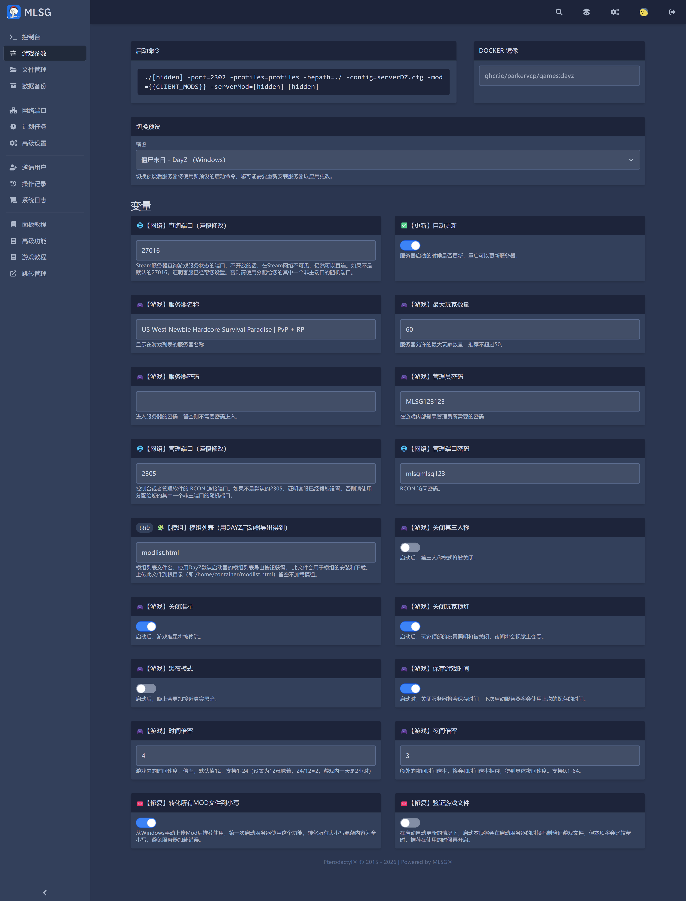
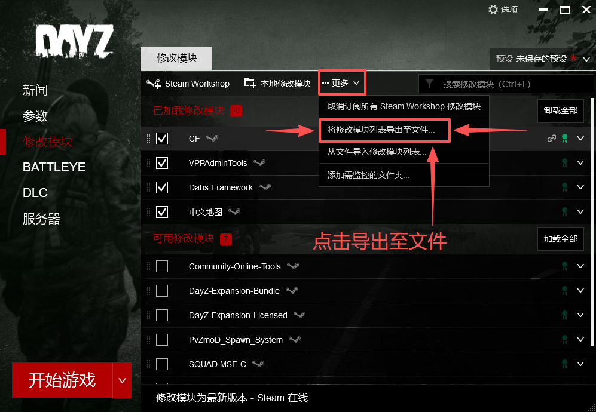

# 僵尸末日（DayZ）
高压生存射击游戏，强调探索、补给与玩家对抗。

---

## 1.推荐配置
- 轻度游玩（10-20人）：4C / 8G
- 常规游玩（20-40人）：6C / 12G
- 高负载（40人以上+大量模组）：8C / 16G+

## 2.开服教程

### 2.1 服务器参数

**绝大部分设置都在【游戏参数】分页里改**，见下图：

**⚠️注意：修改参数后务必 ➡ 重启服务器，才能生效。**  
**ℹ️提示：启动命令与 Docker 镜像由我们维护，不要手动改；切换预设后重启即可应用。**

<strong>【游戏参数】：查询端口、服务器名称、人数、密码、管理员密码、模组列表、时间倍率等</strong>

  <!-- 完美间距 -->

### 2.2 参数说明

**ℹ️变量名前的图标表示分类：** **🎮游戏 / ⚙️网络 / 🔴高级 / 🧩模组 / 🔧修复 / 🔄更新**

| 变量 | 分类 | 说明 |
| --- | --- | --- |
| 服务器名称 | 🎮游戏 | 显示在游戏服务器列表里的名字 |
| 最大玩家数量 | 🎮游戏 | 允许的最大人数，默认 60，**推荐不超过 50** |
| 服务器密码 | 🎮游戏 | 进入服务器需要的密码，**留空则免密进入** |
| 管理员密码 | 🔴高级 | 游戏内登录管理员用的密码（见 3.管理指令） |
| 关闭第三人称 | 🎮游戏 | 开启后第三人称视角关闭，只能第一人称 |
| 关闭准星 | 🎮游戏 | 开启后移除准星 |
| 关闭玩家顶灯 | 🎮游戏 | 开启后玩家头顶的夜视照明关闭，夜间视觉变黑 |
| 黑夜模式 | 🎮游戏 | 开启后夜晚更接近真实黑暗 |
| 保存游戏时间 | 🎮游戏 | 开启后关闭服务器会保存时间，下次启动接着上次的时间走 |
| 时间倍率 | 🎮游戏 | 游戏内时间流速，默认 12，支持 1-24（12 表示 24÷12=2，游戏内一天 2 小时） |
| 夜间倍率 | 🎮游戏 | 额外的夜间时间倍率，和时间倍率相乘，支持 0.1-64 |
| 查询端口 | ⚙️网络 | Steam 查询端口，**默认 27016，谨慎修改**；不开放时 Steam 列表里看不到，但仍可直连。不是 27016 说明客服已帮你调整，请用分配给你的那个端口 |
| 管理端口 | ⚙️网络 | RCON 连接端口，**默认 2305，谨慎修改** |
| 管理端口密码 | ⚙️网络 | RCON 访问密码 |
| 模组列表 | 🧩模组（只读） | 模组列表文件名，默认 `modlist.html`，导出流程见 2.3；**留空则不加载任何模组** |
| 转化所有MOD文件到小写 | 🔧修复 | 从 Windows 手动上传 Mod 后推荐开启，把大小写混乱的文件名统一转小写，避免服务器加载报错 |
| 验证游戏文件 | 🔧修复 | 在开启自动更新时，启动前强制校验游戏文件；比较费时，需要时再开 |
| 自动更新 | 🔄更新 | 服务器启动时检查更新，重启即可更新到最新版本 |

### 2.3 安装模组（首选：启动器导出列表）

**✅首选：用 DayZ 启动器把模组列表导出成文件，服务器会自动按列表下载安装。**

> 1. 打开 **DayZ 启动器** → 左侧 **修改模块**（Steam Workshop 那一栏），勾选要装的模组
> 2. 右上角 **更多 ▾** → **将修改模块列表导出至文件…**
> 3. 得到一个 HTML 文件，**文件名要和后台 `模组列表` 变量里的名字一致**（默认 `modlist.html`）
> 4. 到后台 **【文件管理】**，把该文件上传到根目录，即 `/home/container/modlist.html`
> 5. **重启服务器**，脚本会按列表校验并下载模组

**⚠️注意：客户端也要装同一批模组，否则进服会被踢；下载结果看【系统日志】。**  
**ℹ️备选：模组很少时可手动在【游戏参数】把 `模组列表` 改成别的文件名，再上传同名文件；留空则不加载模组。**

<strong>DayZ 启动器 → 修改模块 → 更多 → 将修改模块列表导出至文件…</strong>

  <!-- 完美间距 -->

### 2.4 开服后检查

> 1. 到 **【控制台】** 确认启动完成、没有报错
> 2. 到 **【系统日志】→ 启动日志** 排查端口占用、模组下载失败等问题
> 3. 游戏里用 **IP:2302** 直连测试（端口见启动命令里的 `-port=2302`）
> 4. 确认 Steam 服务器列表能看到你的服，看不到就是查询端口没放开（见 2.2 的 `查询端口`）

## 3.管理指令

**要使用管理员指令**，在游戏内按 **P** 打开聊天框，输入下表中的指令：

**ℹ️提示：需要远程管理时，用 RCON 连接（管理端口 `2305` + `管理端口密码`）。**  
**⚠️注意：管理员密码不要留成示例值，改完密码需要重启服务器。**

| 指令 | 说明 |
| --- | --- |
| `#login 管理员密码` | 登录管理员权限，密码就是【游戏参数】里的 `管理员密码` |
| `#logout` | 退出管理员权限 |
| `#kick 玩家名` | 踢出指定玩家 |
| `#ban 玩家名` | 封禁指定玩家 |
| `#shutdown` | 立即关闭服务器（重启后生效） |

## 4.加入游戏

> 1. 打开 DayZ，进入 **服务器** 列表，搜索服务器名称（需要查询端口已放开）
> 2. 搜不到就直连：**IP 填服务器地址，端口填 `2302`**
> 3. 设了密码的话，进入时会要求输入 `服务器密码`
> 4. 卡在"正在等待主机"，通常是客户端模组和服务器不一致

## 5.备份与存档

**✅首选：左侧【数据备份】分页直接创建备份、还原备份。**

> 1. 备份前**先关闭服务器**（【控制台】→ 停止）
> 2. 【数据备份】→ 创建备份 → 输入名字 → 确认
> 3. 需要回档时在同一页选备份点还原，再启动服务器

**ℹ️建议：模组大改、换地图、跨版本更新之前都先备份一次。**

## 6.常见问题排查

| 现象 | 排查方向 |
| --- | --- |
| 服务器列表搜不到 | 查询端口（默认 27016）没放开；已改端口的话用客服分配的端口 |
| 客户端一直连不上 | 确认用的是 `2302` 端口，不是查询端口；确认服务器已启动完成 |
| 进服被踢 / 报模组错误 | 客户端与服务器的 `模组列表` 不一致，重新按 2.3 导出并上传 |
| 启动就崩溃 | 看【系统日志】→ 启动日志；多为参数拼写或模组文件大小写问题（开 `转化所有MOD文件到小写`） |
| 夜间太黑看不清 | 关闭 `黑夜模式`、调低 `夜间倍率`，或开启 `关闭玩家顶灯` |
| 时间过得太快 | `时间倍率` 调小（默认 12，越大越快） |
