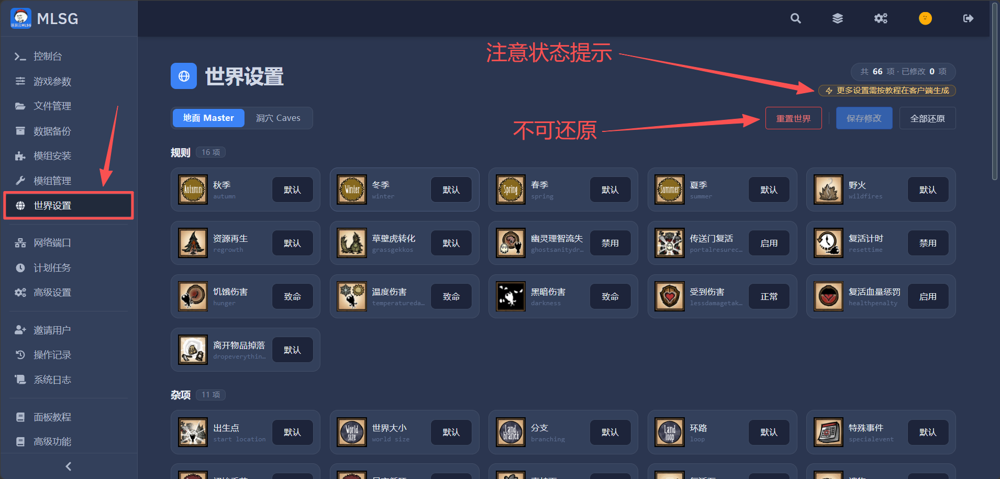
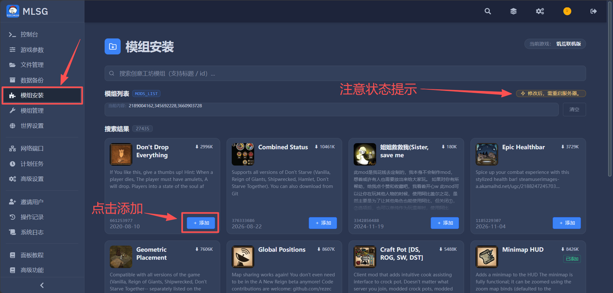
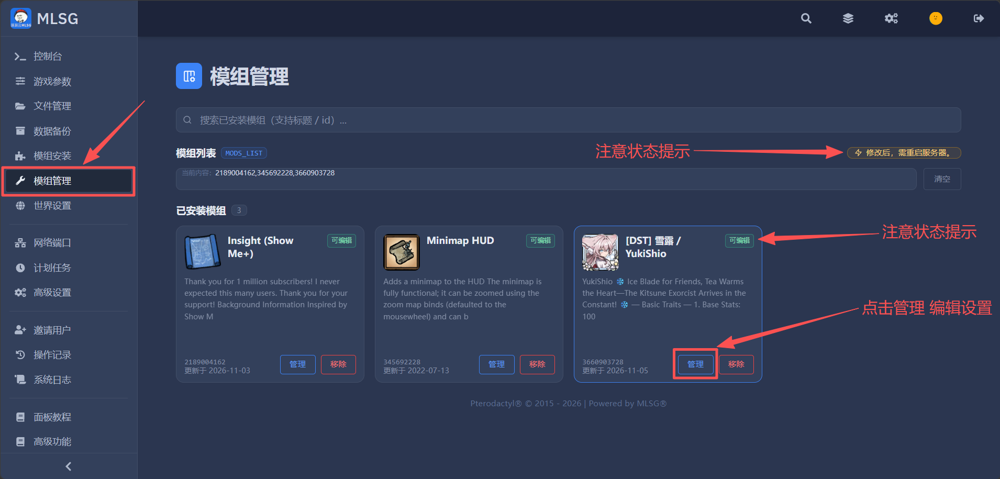
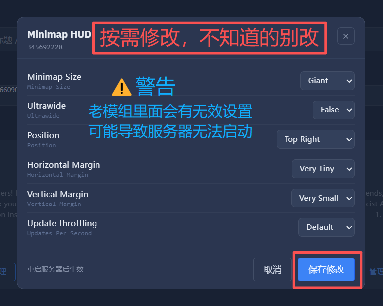
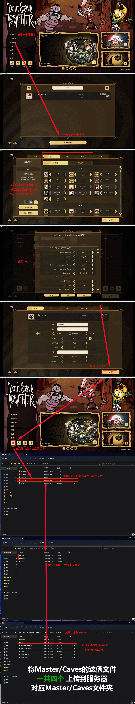
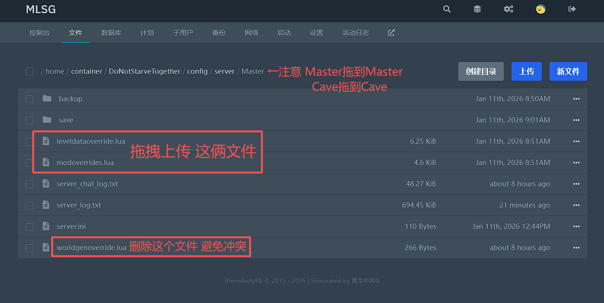
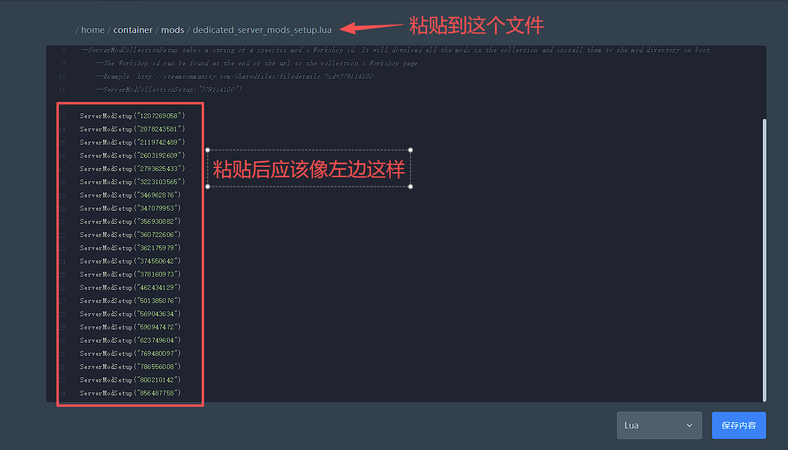

# 饥荒联机版（Don't Starve Together）
一款年久失修，但非常经典的2.5D生存游戏。

---

## 1.推荐配置

**由于该游戏几乎是单核心为主的，单核心性能对于多人的模组服影响巨大。**  
<iframe src="/tools/quick_server_selector.html?game=dst"
    width="510px" 
    height="370px" 
    style="border: 1px solid #ccc; border-radius: 8px;" 
>
</iframe>
 

## 2.开服教程

**首次设置服务器，请仔细阅读以下内容**  

### 2.1.生成服务器Token
获取一个服务器Token，用于服主识别/模组下载，Token生成网址➡  **[克雷官网 - Klei Account](https://accounts.klei.com/account/game/servers?game=DontStarveTogether){target=_blank}**  

### 2.2.填入服务器Token
**将获取到的Token填在服务器后台的[【游戏参数】](/1-serverbasics/){target=_blank}分页变量栏里**, 为避免没能刷入文件内：  
将Token填在 `/home/container/DoNotStarveTogether/config/server/cluster_token.txt`  

  

### 2.3.世界设置（推荐）

**✅首选：左侧【世界设置】直接可视化调参。**

> 1. 打开左侧 **世界设置**
> 2. 顶部切换 **地面 Master** / **洞穴 Caves**
> 3. 按需调整，分别点击保存
> 4. **⚠️世界生成参数只在"重新生成世界"时生效**

**✅要重开世界：见第 4 章「重置服务器（世界）」。**

**ℹ️ 客户端生成的 `leveldataoverride.lua` 依然可用，见 2.6 的手动方案。**

  

### 2.4.模组安装（推荐）

**✅首选：左侧【模组安装】直接搜创意工坊。**

> 1. 打开左侧 **模组安装**
> 2. 搜索框输入模组名称或 ID（两种都支持，输入后自动搜索）
> 3. 勾选要装的模组并添加，已装过的会标 **已添加**
> 4. 下方"模组列表"会实时回显当前生效的模组 ID
> 5. **重启服务器**，脚本会自动下载

**⚠️注意：下载结果请到【系统日志】→ 饥荒模组日志 查看，下载失败时整段日志发给客服。**

  

### 2.5.模组管理（推荐）

**✅首选：左侧【模组管理】，可视化表单改模组参数。**

> 1. 打开左侧 **模组管理**，看到已装模组列表与状态徽章
> 2. 徽章含义：
>    - **未下载**（橙）：还没下载，重启下载
>    - **有更新**（红）：有新版，需重启更新
>    - **无设置项**：模组没有可调参数
>    - **待生效**（蓝）：已保存未生效，**重启后生效**
>    - **可编辑**：可以点进去改参数
>    - **需重启**（灰）：设置还没生成，重启后再编辑
> 3. 点 **可编辑** 进入表单，按需修改参数后 **保存**
> 4. 不用的模组点 **移除**，会一并清理本地残留

**⚠️注意：模组参数改完后需重启服务器才会生效。**

**ℹ️ 下面的 2.6 ~ 2.8 是"手动传文件"的备选方案，服务器无法正常工作可以使用。**
**ℹ️ 需要在【游戏参数】页面关闭 面板控制 功能，才能使用手动方案。**

  
  

### 2.6.世界生成（手动）
> 1. 文件 **`worldgenoverride.lua`** 控制世界生成参数

> 2. 在服务器上找到 **`/home/container/DoNotStarveTogether/config/server/Master`** 和 **`Caves`**文件夹  

> 3. 在本地找到配置文件 **`leveldataoverride.lua`** （刚创建的世界生成的对应配置文件）

> 4. 把主世界和地洞**各一个** **`leveldataoverride.lua`** 上传到服务器对应文件夹（Master和Caves）
  
**⚠️注意：同文件主世界/洞穴各一个，内容不同。原本 `leveldataoverride.lua` 客户端专用，`worldgenoverride.lua` 服务器专用，功能一样，现服务器已可读取前者，故删除后者即可**  

### 2.7.配置MOD（手动）
> 1. 文件 **`modoverrides.lua`** 控制mod开启和设置

> 2. 在服务器上找到 **`/home/container/DoNotStarveTogether/config/server/Master`** 和 **`Caves`**文件夹  

> 3. 在本地找到配置文件 **`modoverrides.lua`** （刚创建的世界生成的对应配置文件）

> 4. 把主世界和地洞**各一个** **`modoverrides.lua`** 上传到服务器对应文件夹（Master和Caves）
  
**⚠️注意：同文件主世界/洞穴各一个，且内容不同。由于该配置文件为全英文，模组设置参数名称和游戏内不一样，强烈建议在客户端操作修改mod的配置，不推荐在服务器端手动修改**   

  
  

### 2.8.下载MOD（手动）
**✅现在只需上传 `modoverrides.lua`，服务器会自动下载所需MOD。**
  

> 1. 文件 **`dedicated_server_mods_setup.lua`** 控制mod下载设置

> 2. 在服务器上找到 **`/home/container/mods`** 文件夹

> 3. 使用下面的转换器，黏贴 **`modoverrides.lua`** 文件内容

> 4. 点击生成对应的 **`dedicated_server_mods_setup.lua`** 文件内容

> 5. 将生成的内容，粘贴到服务器 **`/home/container/mods`** 对应文件

<iframe src="/tools/dst_mod_setup.html" 
    width="100%" 
    height="500" 
    style="border: 1px solid #ccc; border-radius: 8px; overflow: hidden;" 
    scrolling="no">
</iframe>

**将生成的 `dedicated_server_mods_setup.lua` 文件内容，粘贴到服务器对应文件即可, 如下图**  
  
 

## 3.注意事项

一些通用的注意事项，强烈建议阅读  

### 3.1.已知BUG

- **该游戏由于年久失修，后台落后，操作不便是常态**
- **服务器Ping显示为???的问题，无法完美解决，等待一会会变化，之后每次都会显示** - 开发团队说只需要一个端口就应该可以显示ping，但实践中，该问题游戏发售起直至今天仍然天天发生。本问题无法解决，官方未对此进行Debug。Ping显示为???的原因猜测为：游戏开发时为了避免同一时间发出太多ICMP ECHO包，每个服务器只客户端只会Ping一次。导致一旦该Ping丢包（不管是服务器，还是客户端，还是中间网络丢包）会客户端都会显示为???  

### 3.2.弃用MOD

- **由于【五格装备】作者不再更新，很多Mod与其不兼容**，会导致世界崩溃  
- **很多Mod都有新老版本多个分支**，安装前注意更新日期，并在客户端测试是否能正常运行，避免服务器崩溃

 

## 4.重置服务器（世界）

**✅首选：游戏内使用 ESC 菜单的重置世界功能，更稳定，且不需要重启服务器**  
**ℹ️备选：后台左侧【世界设置】→ 点击右上角【重置世界】**  
**🔴重装：在【文件管理】页面勾选删除所有文件，然后在【高级设置】页面点击重装服务器**  
 

## 5.服务器指令（作弊）

**服务器后台输入指令位置，[请看本页](/1-serverbasics/)（部分指令需要在服务器后台使用）**  
**游戏内使用指令：按下 `~` 键（ESC下面的键），或 `shift + ~` 键打开控制台**  
**（游戏内使用指令需管理员/房主身份，且确保控制台显示为remote模式）**  

| 常用指令 | 说明 |
| --- | --- |
| c_shutdown() | 【关闭服务器】关闭会自动存档 |
| c_freecrafting() | 【创造模式】免费制作物品 |
| c_godmode() | 【上帝模式】不掉血不会死 |
| c_supergodmode() | 【超级上帝】满状态且上帝 |
| c_speedmult(倍数) | 【速度倍数】调整移动速度 |
| c_regenerateworld() | 【重置世界】重新生成世界 |
| c_listallplayers() | 【列出所有玩家】显示在服务器后台 |
| c_announce("内容") | 【公告】向所有玩家发送公告 |
| c_save() | 【保存游戏】可在一天任意时刻保存 |
| c_rollback(天数) | 【回档】警告！超过快照天数会重置世界 |
| c_goto(AllPlayers[玩家编号]) | 【传送到玩家】游戏内按Tab看玩家顺序 |
  
更多指令推荐参考[灰机Wiki的指令列表](https://dontstarve.huijiwiki.com/wiki/%E6%95%99%E7%A8%8B/%E5%B8%B8%E7%94%A8%E6%8E%A7%E5%88%B6%E5%8F%B0%E6%8C%87%E4%BB%A4)  
 

## 6.模组配置器（高级）

**ℹ️ 日常改模组参数请直接用左侧【模组管理】（见 2.5），本页只在需要直接改文本时使用。**  
手动编辑模组配置文件，**无法添加Mod和Mod参数**，因为太容易导致报错，强烈建议[用客户端添加](/3-servergames/dontstarve/#27mod)。  
  
**🔴警告：如果您是新手，强烈不推荐使用，不正确的操作会导致服务器崩溃，或模组不加载。**  
  
✅直接在下方的窗口使用，全屏打开点击➡ <a href="/tools/dst_mod_edit.html" target="_blank">饥荒Mod配置编辑器</a>。  
<iframe src="/tools/dst_mod_edit.html" 
    width="100%" 
    height="1000" 
    style="border: 1px solid #ccc; border-radius: 8px;" 
>
</iframe>
